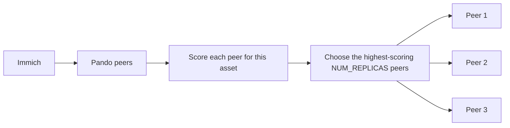

# Pando

Back up your Immich photos across several machines, with no central server.

One disk, or one house, is a single point of failure for a photo library. Pando
runs the same service on every peer and uses rendezvous hashing to decide which
peers store each Immich asset, so the placement does not require a central
database or coordinator.

Self-hosting photos on one box is a single point of failure, and existing tools
often require a central server or cloud service.

## Status

Pando is early-stage software. It is not yet recommended as your only backup;
keep your original Immich data and use Pando as an additional copy.

The current implementation provides continuous polling, deterministic asset
placement, peer registration, bulk and individual asset downloads, a persistent
manifest, and a web dashboard. It does not yet provide peer API authentication,
encrypted peer transport, cross-peer manifest reconciliation, quorum or
verified writes, automatic peer removal or rebalancing, or a metrics endpoint.

## Dashboard

<!--  -->

Open `http://localhost:8080/dashboard` to see cluster health, node reachability,
storage, photo counts, and look up where an asset is stored. The screenshot link
is intentionally commented out until `docs/dashboard.png` is added.

## How it works



- A **peer** is one running Pando process with its own backup directory and persistent ID. Every peer runs the same code, and there is no coordinator or shared database.
- Pando checks Immich access and local storage before starting its backup loop.
- A new peer registers with any existing peer, called the **seed peer**. That peer relays the peer list. After joining, the seed peer has no special role.
- Rendezvous hashing assigns each asset to the configured number of **replicas**, meaning independent peer copies.
- Each peer polls Immich, downloads its assignments, and records successful downloads in a **manifest**, a map of asset IDs to their original filenames.
- The dashboard reports cluster state, node health, storage, and asset locations.

## Design decisions

- **Leaderless placement.** Rendezvous hashing means any peer can compute where an asset lives. When a peer joins or leaves, only the assets it ranked for move, instead of reshuffling everything.
- **Immich as the source of truth.** Pando polls Immich and downloads assignments, so it does not need to intercept uploads.
- **Manifest per peer.** Each peer records what it holds, written atomically, so restarts do not re-download everything.
- **Known trade-off.** Membership is a static peer list for now, so a dead peer is not detected or replaced yet (see Roadmap).

## Quick start with Docker Compose

Requirements: Docker Compose, a reachable Immich server, an Immich API key, and
network connectivity between the Pando peers.

1. Copy the example environment file:

   ```sh
   cp .env.example .env
   ```

2. Edit `.env` and set the Immich URL and API token, a reachable `SELF_URL`,
  the seed peer URL, `NUM_PEERS`, and `NUM_REPLICAS`. For a one-node test,
   use `NUM_PEERS=1`, `NUM_REPLICAS=1`, and point both peer URLs at that node.
3. Build and start Pando:

   ```sh
    docker compose pull
    docker compose up -d
   ```

4. Open [http://localhost:8080/dashboard](http://localhost:8080/dashboard).

The Compose file mounts `./data` at `/backup` and sets
`BACKUP_FOLDER_PATH=/backup`, so the value in `.env` is overridden for this
Compose setup. The `:z` volume label is needed on Fedora and other SELinux
environments. Compose uses `network_mode: host` so the container can use host
networking and private-network connectivity such as NetBird or Tailscale.
Compose pulls the published image from GitHub Container Registry.

When using `docker run --env-file` directly, use unquoted values in the env
file. Keep the backup volume mounted at the path in `BACKUP_FOLDER_PATH`, and
make sure each peer has a distinct `SELF_URL`, listening port, and backup
directory.

## Run from source

The repository requires Go 1.27.1, as specified in `go.mod`.

```sh
go run .
```

To build and run the binary:

```sh
go build -o pando .
./pando
```

Pando validates the Immich API key and permissions, checks that the backup
directory exists, checks available storage against the Immich user's quota,
loads or creates the persistent peer ID, and starts the HTTP server. The
service then waits for the configured number of healthy peers before polling
Immich. Asset polling is cursor-based; after a completed scan, the next scan
starts after one minute.

## Configuration

Pando reads environment variables and an optional `.env` file.

| Variable | Required | Default | Description |
| --- | --- | --- | --- |
| `IMMICH_URL` | Yes | None | Base Immich URL, such as `http://immich:2283`. |
| `IMMICH_API_TOKEN` | Yes | None | Immich API key. |
| `SELF_URL` | Yes | None | URL other peers use to reach this peer. |
| `BACKUP_FOLDER_PATH` | Yes | None | Existing directory for downloaded assets and settings. |
| `SEED_PEER_URL` | Yes | None | Peer URL used for initial registration. |
| `NUM_PEERS` | Yes | `0` when unset or invalid | Expected total number of peers. |
| `NUM_REPLICAS` | Yes | `0` when unset or invalid | Number of peers that should store each asset. |
| `LISTEN_PORT` | No | `8080` | HTTP port for this peer. |
| `TIME_ZONE` | No | `UTC` | IANA time zone used for timestamps. |
| `MIN_FREE_BYTES` | No | `5368709120` | Minimum free bytes required before an asset download begins. |
| `STORAGE_RECHECK_SECONDS` | No | `60` | Seconds between free-space checks while waiting to download. |

`NUM_REPLICAS` should not exceed `NUM_PEERS`. The backup directory must exist
before startup. Peer IDs are stored at
`<BACKUP_FOLDER_PATH>/settings/id.txt`.

## HTTP API

The server listens on `LISTEN_PORT`. The dashboard and status endpoints are
useful for operators; peer and asset-location endpoints are internal cluster
APIs.

| Method | Path | Purpose |
| --- | --- | --- |
| `GET` | `/dashboard` | Dashboard with cluster, node, storage, and asset lookup views. |
| `GET` | `/storage` | Local storage totals and free space. |
| `GET` | `/cluster/status` | Aggregated status for known nodes. |
| `GET` | `/manifest` | Paginated manifest entries. |
| `GET` | `/status` | Service state, counters, settings, and recent error information. |
| `GET` | `/health` | Runs the Immich and local storage health checks. |
| `POST` | `/registerPeer` | **Internal:** register or update one peer. |
| `GET` | `/relayPeers` | **Internal:** return the peers known by this node. |
| `POST` | `/registerPeersReceived` | **Internal:** accept a relayed peer list. |
| `GET` | `/doesThisNodeHaveImage` | **Internal:** check whether this node has an asset. |
| `GET` | `/whichNodeHasThisImage` | **Internal:** find the peers assigned to or storing an asset. |

Peer registration and asset-location endpoints are unauthenticated and are
intended for a private network. Do not expose them directly to the internet.

### Manifest pagination

`GET /manifest` accepts `limit`, an integer from `1` to `1000` that defaults to
`100`, and `after`, an optional asset ID cursor. Entries are sorted by asset ID.
Use `nextCursor` as the next `after` value until it is `null`.

```json
{
  "items": [
    { "assetId": "asset-id-1", "fileName": "photo-one.jpg" }
  ],
  "total": 1250,
  "nextCursor": "asset-id-1"
}
```

The manifest is stored at
`<BACKUP_FOLDER_PATH>/settings/asset-manifest.json`. Files are stored in the
backup root using their Immich asset ID plus the original extension. Archive
temporary directories and downloaded archives are removed after successful
extraction.

## Roadmap

Done:

- Immich API-key and local storage health checks
- Persistent peer IDs and peer registration relay
- Deterministic multi-peer asset placement
- Cursor-based asset polling
- Bulk downloads and individual fallback downloads
- Atomic manifest updates and paginated manifest API
- Cluster dashboard with node, storage, health, and asset lookup views

Planned:

- [ ] Detect peer failures and mark assignments unavailable automatically
- [ ] Authenticate peer endpoints
- [ ] Reconcile manifests between peers
- [ ] Add quorum or verified-write handling
- [ ] Add a dashboard action to remove a peer
- [ ] Show the count of under-replicated photos in the dashboard
- [ ] Add a metrics endpoint

## Contributing

Pando is small enough to understand by following one feature through its
handler, store, and tests. Start with the [contributor guide](CONTRIBUTING.md),
run the tests before and after a change, and keep pull requests focused.
Documentation, tests, dashboard work, and operational improvements are all
useful contributions.

Good first issues:

- Add handler tests for the dashboard's method and response behavior.
- Add a dashboard indicator for under-replicated assets once detection exists.
- Add tests for manifest reconciliation edge cases.
- Add method validation and response tests for internal peer endpoints.

## License

Pando is released under the [MIT License](LICENSE).
